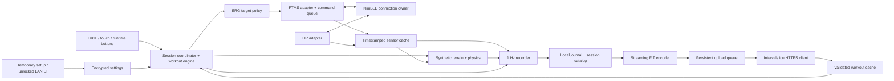

# TrainerLoop ESP32 migration specification

Phase 0 — investigation and design record. Inspected 2026-09-16. Target: **Waveshare ESP32-S3-Touch-AMOLED-1.8 V1**, SH8601 + FT3168. The behavior below was proposed during the investigation; the user subsequently authorized phased implementation. This document remains the design and acceptance source. It does not authorize flashing, erasure, eFuse changes, or other device-state changes by itself.

## 1. Executive summary

Build a standalone ERG cycling computer using ESP-IDF, NimBLE, LVGL, durable local recording, and direct HTTPS access to Intervals.icu. A browser on a computer or phone is used for initial configuration; no companion application or phone is needed while riding. The device owns the workout clock and trainer control. Wi-Fi supports synchronization and uploads but is never required to execute a cached workout or save a ride.

The Android application provides reusable behavioral references for FTMS/HR parsing, steps and ramps, synthetic terrain, cycling physics, FIT fields, and Intervals.icu requests. Its Android UI, persistence implementation, permissive FTMS acknowledgements, and in-memory recording are not suitable for literal transplantation. P0 adds durable workout caching, power-loss recovery, explicit control acknowledgement, separate wall/active/plan clocks, and a persistent upload queue.

**ERG and simulation remain independent:** workout targets determine resistance; actual measured power and synthetic grade determine virtual speed, distance, and elevation. The simulator has no trainer-command interface. No GPX, GPS coordinates, maps, virtual drivetrain, or route-driven resistance enters P0.

Hardware feasibility is strong on the documented V1 specifications, but physical verification is incomplete. USB enumeration confirms an Espressif native USB debug device; it does not verify silicon revision, actual flash capacity, installed firmware, partition layout, SD presence, or remaining storage. The current firmware was not interrupted or queried with unknown commands. These are explicit implementation gates, not assumed measurements.

The most important safety limit is physical: **after BLE communication is lost, the ESP32 cannot command resistance to decrease.** Safe release on link loss must be characterized on the actual Zwift Hub One. Until then the system can pause, alarm, and instruct the rider to stop pedaling, but cannot promise automatic resistance release. This is a P0 release gate.

### Investigation boundary and Git baseline

- Reference: `/Users/david.ramirez/Projects/trainer-loop`, HEAD `b693b4c9d47878475378221a55cd22e4ea173adb`. The working tree, including uncommitted changes, is the behavioral reference.
- Seven existing modified files: `android/app/src/main/java/com/trainerloop/app/TrainerLoopApplication.kt`; `ble/HrManager.kt`; `domain/coach/AnalyticsEngine.kt`; `domain/coach/FeedbackDecisionEngine.kt`; and tests `ble/HrManagerSharedConnectionTest.kt`, `domain/coach/FeedbackDecisionEngineTest.kt`, `domain/coach/LiveCoachPipelineTest.kt` under `android/app/src/test/java/com/trainerloop/`. The shortened production paths share `android/app/src/main/java/com/trainerloop/`.
- Target directory was empty. It is **not a separate Git repository**: Git resolves its root to `/Users/david.ramirez/Projects/Personal`. That parent reports existing unrelated untracked sibling directories and `.DS_Store`; none are part of this migration or changed by it.
- Read root `AGENTS.md`, both READMEs, `docs/agents/domain.md`, relevant implementation/roadmap/simulation/GPX/Click/sync plans, production code and tests. No root CONTEXT.md or ADR files were found by the scoped inventory.
- No reference files changed; no Gradle build/test execution, because it would write build artifacts into the reference. Tests were inspected as evidence, **not reported as passing**. No firmware, build files, drivers, dependencies, flash images, or hardware configuration were created or installed.

## 2. Verified Waveshare V1 hardware inventory

“Documented” means supported by manufacturer sources, not measured on the attached unit. The user's V1 identification fixes the design. [Waveshare hardware documentation](https://docs.waveshare.com/ESP32-S3-Touch-AMOLED-1.8) explicitly distinguishes SH8601/FT3168 V1 from CO5300/CST820 V2.

| Item | Evidence and confidence | Design consequence |
|---|---|---|
| Attached USB | Host `ioreg` reports Espressif, “USB JTAG/serial debug unit”, VID 12346 = 0x303A, PID 4097 = 0x1001; `/dev/cu.usbmodem2101` exists | Native USB interface verified; descriptor is not a board identity or firmware fingerprint |
| MCU | V1 documented ESP32-S3R8, dual Xtensa LX7, up to 240 MHz | ESP32-S3 target; actual silicon revision unread |
| RAM/flash | Documented 8 MB PSRAM, 16 MB NOR flash | Capacity budget only; actual JEDEC capacity, PSRAM health, partition sizes/free bytes unverified |
| Display/touch | Documented 368×448 AMOLED, SH8601 QSPI, FT3168 I2C | Fixed portrait P0; no V2 controller substitution |
| Radio | Documented 2.4 GHz Wi-Fi, Bluetooth LE | Two simultaneous BLE peripheral connections; no Bluetooth Classic/ANT+ assumption |
| RTC/IMU | PCF85063, QMI8658 | RTC time retention; IMU unused in P0 |
| Power/input | AXP2101, PWR/BOOT, battery connector and RTC backup provision | Battery/backup-cell presence and power-button behavior need physical verification |
| Storage/audio | TF slot; ES8311, speaker/microphone | SD optional; microphone unused; no audio needed for core ride controls |

### Board-support and pin audit

The original Waveshare [V1 pin header](https://github.com/waveshareteam/ESP32-S3-Touch-AMOLED-1.8/blob/main/examples/arduino/libraries/Mylibrary/pin_config.h) and [FT3168/SH8601 example](https://github.com/waveshareteam/ESP32-S3-Touch-AMOLED-1.8/blob/main/examples/arduino/examples/04_GFX_FT3168_Image/04_GFX_FT3168_Image.ino) agree with the managed BSP on these primary pins. These are source-verified assignments, not electrical continuity measurements.

| Function | ESP32 GPIO / path |
|---|---|
| SH8601 QSPI CS / CLK | 12 / 11 |
| QSPI D0 / D1 / D2 / D3 | 4 / 5 / 6 / 7 |
| Shared I2C SDA / SCL | 15 / 14 |
| Touch interrupt | 21 |
| Display/touch reset and enables | I2C expander at 0x20; original example drives expander outputs 0–2 low then high; **not ESP32 GPIO 0–2** |
| TF SDMMC one-bit CMD / CLK / D0 | 1 / 2 / 3 |
| Audio MCLK / BCLK / LRCLK | 16 / 9 / 45 |
| Audio ESP output / input; amplifier | 8 / 10; enable 46 (BSP naming) |
| BOOT | GPIO0 strapping input; do not hold across power-on for ordinary runtime gestures |
| PWR | AXP2101 power-key path; not interchangeable with BOOT |
| USB D− / D+ | ESP32-S3 native USB GPIO19 / GPIO20; reserve for USB |

The [manufacturer schematic](https://files.waveshare.com/wiki/ESP32-S3-Touch-AMOLED-1.8/ESP32-S3-Touch-AMOLED-1.8.pdf) also shows the expander/power and SD wiring. Exact reset/enable net mapping, PMU interrupt handling, rail voltages, and shutdown sequencing must be checked visually against this schematic and the physical revision before initialization code is written. Do not blindly toggle expander outputs or PMU registers. No I2C probe or register writes were performed.

**BSP compatibility trap:** the current [quickstart manifest](https://github.com/waveshareteam/ESP32-S3-Touch-AMOLED-1.8/blob/main/examples/esp-idf/00_bsp_quickstart/main/idf_component.yml) requests IDF `>=5.5,<6.1` and BSP `^2.0.3`. The [2.0.3 registry entry](https://components.espressif.com/components/waveshare/esp32_s3_touch_amoled_1_8/versions/2.0.3/readme) retains a V1→`^1` compatibility row. Its linked [source revision](https://github.com/waveshareteam/Waveshare-ESP32-components/tree/9f4030c6e5cb888ad4cc268bfa7584c93ad53e30/bsp/esp32_s3_touch_amoled_1_8) actually constructs a **CO5300 panel**, with FT5x06/CST816-family touch detection. Therefore do not adopt that latest BSP wholesale for this V1 design. Its header also reports buttons/IMU capabilities as zero despite physical hardware being present: BSP coverage and hardware inventory differ.

Recommendation: ESP-IDF 5.5 release line, exact supported patch pinned during bring-up; a small V1 board adapter using an audited SH8601 driver and FT3168-compatible touch driver. Inspect a V1 BSP release before selecting it; no exact V1 BSP version is yet approved. Reuse verified pin/power knowledge, not V2 initialization. Library family names such as FT5x06 do not by themselves prove FT3168 compatibility.

### What could not be verified without changing runtime state

No serial port was opened, no DTR/RTS reset, ROM-loader entry, JTAG halt, esptool stub, flash read/erase/write, eFuse operation, or boot-button gesture was used. Even nominally read-only esptool commands may reset a running board or load a RAM stub. USB descriptors cannot answer the remaining questions.

Before future firmware replacement, obtain the physical rear-label revision and existing firmware's documented diagnostics if available. Record chip revision, JEDEC flash size, PSRAM size, bootloader/security state, application identity, partition table, and SD presence/free space. If no safe existing diagnostic exists, schedule a separately authorized maintenance inspection/backup before bring-up. Do not treat 16 MB advertised capacity as 16 MB free storage. A factory image being available online does not establish what is installed now.

[Espressif's native USB documentation](https://docs.espressif.com/projects/esp-idf/en/v5.5/esp32s3/api-guides/usb-serial-jtag-console.html) confirms that this is a fixed-function serial/JTAG peripheral and documents GPIO19/20. It is not an exposed disk. Any future USB file export needs an application protocol or an explicitly designed USB-OTG mode; the current descriptor provides no way to enumerate onboard files.

## 3. Reference feature inventory

Evidence keys A1–A15 resolve to concrete files and symbols in the source index at the end. **Implemented** means present in production code, with tests where noted; it does not mean physically validated in this investigation. **Partial** means a concrete limitation exists. **Experimental** means an implementation exists but interoperability is not established. **Planned** refers only to documents without verified implementation. **Deferred** describes this ESP32 release scope.

| Area | Current source-backed findings | Status / evidence |
|---|---|---|
| Trainer data | FTMS Indoor Bike Data parses flag-dependent speed, cadence, signed power, resistance, distance, HR and timing; malformed flagged payloads are rejected | Implemented; A1, parser tests |
| ERG commands | Request control, target power, start/resume, stop/pause; 0–2000 W clamp; control-point indication handling | Implemented with safety limitations; A2 |
| GATT ownership | Application owns one trainer connection shared by data/control; operations serialized with a mutex; service discovery once; separate peripheral HR uses a separate connection | Implemented; A3, application/shared-HR tests |
| Shared HR | Uncommitted current `attachHr` supplies trainer FTMS HR flow for same-address device, preserving its timestamps without a second HR subscription | Implemented in dirty working tree; A3. Garmin strap remains standard HRS |
| Reconnect | Backoff 1,2,4,8,15,30 seconds, then 30 repeatedly; rediscovery and manager re-subscription/control request | Implemented; link recovery is not a proven safe ERG restart; A3 |
| Trainer metadata | Optional manufacturer/model reads and battery level read on initial/reconnection setup | Implemented; missing services yield unavailable values, not zero battery; A1 |
| Separate power meter | No separate Cycling Power Service adapter found | Not current parity; future P1 |
| Workouts | Step target ranges, linearly interpolated ramps, phase labels and optional cadence targets; FreeRide model exists | Implemented; A4/A5 |
| Ride controls | Start, pause, resume, skip to next interval, ERG toggle, ±1/±5% intensity bounded ±20%, recovery extension default +30 s | Implemented; A4. ROADMAP's recovery-extension deferral is stale |
| Completion/stop | Stop with samples emits finish data, empty stop has no finish event; natural-completion flag retained. Completion creates FIT; **onSave** persists Room session then attempts upload; discard is available | Implemented, not unconditional autosave; A4/A8 |
| Ramp test | Five-minute 50→100 W warmup; one-minute steps beginning 100 W, +20 W; 5 s below half target ends work phase; suggested FTP 75% best rolling 60 samples; optional FTP push | Implemented; A10; not required P0 |
| Free ride / GPX | Production route parser/repository, distance-domain tracker, virtual drivetrain and free-ride ViewModel; cadence/gears generate ERG targets and route positions | Implemented paths and unit tests, physical fidelity unverified; A11. Not merely an old plan, but excluded from ESP32 P0 |
| Builder/library | Manual step builder; imported/built JSON persistence; search name/description, category filters, favorites sorting, duplication and deletion | Implemented, builder partial relative to ramp/editing parity; A9 |
| File import | ZWO, MRC, ERG, JSON dispatch and parsers; GPX separate route path | Implemented; A5/A11, parser/import contract tests |
| Synthetic terrain | Deterministic time-domain terrain, actual-power speed, distance/elevation stamping, expected chart profile | Implemented; A6, simulation tests |
| Recording/history | Nominal 1 Hz samples buffered in RAM, StateFlow snapshot every 5 s; saved JSON telemetry in Room; summary/history/detail/share paths | Implemented; no durable in-progress journal established; A7/A8 |
| FIT | Custom encoder/decoder, header/file CRC generation, sensor/virtual fields, summary messages; GPS fields supported for route sessions | Implemented; independent standards validation remains needed; A12 |
| Intervals.icu | Basic auth, athlete FTP/weight sync, today events, ZWO downloads, FIT multipart upload, duplicate heuristic | Implemented; A13/A14 |
| Offline/sync | Home persists name/date only; prefetched normalized workout is in memory. Library sync persists downloaded workouts. Post-save auto upload plus manual history retry and synced timestamp | Partial; no durable automatic retry worker found; A8/A9/A13/A14 |
| Coach/TTS/Click | Coaching pipeline and TTS calls in workout screen; Click manager/protocol and shift integration exist | Coach/TTS implemented; Click interoperability experimental (reverse-engineered protocol); A15 |

Connectivity nuance: manager `isConnected` flags mostly reflect setup/explicit disconnect, while `BleConnection` tracks unexpected link loss separately. Successful reconnect callbacks do not prove every subscription or control command succeeded. Workout clock normally continues during telemetry drops; recorder retains last power/cadence with a dropout flag and clears stale HR to zero. ESP32 must not reproduce misleading “connected” or “fresh” UI from these shortcuts.

History nuance: `SessionDetailScreen` gates its cloud-upload section on `s.completed && state.icuConfigured`, even though `IcuActivityUploader` itself accepts nonempty partial sessions. Thus manual retry visibility for partial stops is limited in the current Android UI. P0 must expose retry for every saved valid partial or complete activity. Android detail also computes normalized power, intensity factor, zone time, distance/ascent and sample charts; basic ESP32 history need not reproduce those charts.

Document-only Android plans include the upcoming-week calendar, RPE/notes writeback, tags, trend charts and trainer spindown in `ROADMAP.md`; no corresponding complete implementation was established in this inspection. Do not classify those as migrated features. Likewise, the roadmap's assertion that recovery extension is deferred is superseded by A4 source/tests.

## 4. Feature-parity matrix

| Feature | Current Android behavior | ESP32 behavior | Priority | Migration notes | Acceptance criterion |
|---|---|---|---|---|---|
| Provisioning | Android settings/network supplied by OS | Temporary protected AP + browser, transactional validation | P0 | New device responsibility | Configure from clean device without companion app |
| Trainer pairing | BLE scan/select, shared GATT | Select Hub, persist identity, discover capabilities | P0 | No name-only auto-selection | Correct trainer reconnects after reboot |
| FTMS telemetry | Power/cadence parser | Same units/flags, independent per-field freshness | P0 | Do not use flywheel speed as virtual speed | Packet vectors and actual Hub match |
| ERG control | Commands, permissive control timeout | Serialized acknowledged transactions | P0 | No timeout-as-success fallback | Denied/unacknowledged control cannot start a ride |
| HR | Standard HRS; optional same-trainer HR source | Separate Garmin HRS connection, optional HR | P0 | No ANT+ requirement | HR drop does not interrupt workout |
| Device info/battery | Optional reads | Optional settings detail | P0 basic | Absent data shown unavailable | No pairing failure when metadata absent |
| Auto-reconnect | Backoff and re-subscribe | Recover link into Paused; deliberate resume | P0 | Reacquire control, discard old commands | No uncontrolled target replay |
| Today sync | Home first event; library all today events | Cache all supported cycling workouts for today; choose if multiple | P0 | Full content cache added | Cold offline boot can start cached plan |
| Profile | FTP/weight fetched; local settings | Validated sync with explicit local override | P0 | Freeze session snapshot | Mid-ride sync never changes target or physics |
| Steps/ramps | Range midpoint / linear target | Normalized steps/ramps | P0 | Preserve fractional FTP origin | Boundary/ramp golden vectors match |
| Pause/resume/stop | Clock/command methods, partial completion | Safe pause, explicit resume, automatic durable save | P0 | Distinct wall/active/plan clocks | Stop at 10 min retains partial session |
| Skip/intensity/recovery | All implemented | Later controls through engine commands | P1 | P0 controls remain simpler | Later skip does not advance FIT timestamp artificially |
| Ramp test | Built-in protocol and FTP estimate | Later dedicated test mode | P1 | Ordinary imported ramps already P0 | Later result excludes invalid samples |
| Free ride | ERG-backed virtual drivetrain / GPX | No free-ride route mode | Deferred | Separate controller strategy | P0 never issues route-driven targets |
| Builder/authoring | Step builder; other forms imported | No device authoring | Deferred | Intervals.icu is workout source | No on-device workout editor |
| Search/favorites/categories/duplicate | Implemented library functions | Today's list + basic cache metadata | P1 richer library | Duplication does not imply authoring | P0 multiple today plans distinguishable |
| ZWO import | Parser including FreeRide approximation | Intervals ZWO, strict supported subset | P0 | Unsupported control-bearing elements reject plan | No silently shortened workout |
| MRC/ERG/JSON import | Production parsers | USB/web import later | P1 | Same normalized model | Later import cannot bypass validation |
| Synthetic terrain/speed | Implemented time-domain physics | Same core behavior, bounded drop handling | P0 | No trainer command output | Identical ERG commands with simulation on/off |
| Physics settings | FTP/weight, bike/Crr/CdA; virtual toggle | All five editable; frozen for ride | P0 | Reject NaN/range violations | Settings produce expected speed differences |
| Session recording | RAM until explicit save | Journal throughout ride; automatic finalization | P0 | New crash resilience | Valid prefix recovered after power cut |
| FIT | Custom encoder, own decoder tests | Streaming encoder, independent validation | P0 | Add lap/timer events, correct pause timestamps | Garmin tooling decodes entire file |
| Upload/dedup | Post-save attempt, 422 duplicate heuristic | Durable retry queue, deterministic FIT bytes | P0 | Auth blocks separately from network errors | Lost response cannot create endless duplicates |
| History | Calendar/list/detail and sync badge | Recent list, summary, upload status/retry | P0 basic / P1 rich | Bounded storage policy | Browse sessions offline after reboot |
| FIT export | Android share sheet | Local web/USB download later | P1 | No writable mounted live filesystem | Download equals stored FIT hash |
| CPS / external shifter | CPS absent; Click code exists | Adapter extensions later | P1 | Not required for Hub ERG | No P0 dependency on Click |
| Coaching / TTS | Implemented | No live coach or speech | Deferred | Read-only session event subscribers later | P0 works with audio disabled |
| GPX/GPS/maps | GPX and GPS recording exist; map parity not established | Absent | Deferred | Separate distance-domain route source | P0 FIT contains no GPS coordinates |

## 5. P0 / P1 / deferred scope

**P0 release slice:** provision; pair Hub and optional Garmin HR; synchronize profile/today; retain full supported workouts offline; preview; run step/ramp ERG with pause/resume/safe stop; show target/actual power, cadence, HR, elapsed and interval progress, connection states, virtual speed and grade/elevation; edit FTP, rider/bike weight, Crr/CdA outside rides; record and recover local sessions; generate validated FIT; queue/upload reliably; browse local summaries. Initial limits: up to 4 h per workout, 2,000 normalized segments, 256 KiB downloaded ZWO. These are proposed product limits to validate against actual account workouts, not Android parity limits.

**P1:** richer history and library, search/favorites/categories, external imports and manual FIT export, skip/intensity/recovery controls, dedicated ramp-test workflow, separate Cycling Power Service, external control adapters, optional simple post-interval cues, additional profile/training metrics. P1 controls must preserve the single ERG controller and recording invariants. A Click adapter alone does not bring virtual drivetrain mode into scope.

| Deferred feature | Reason | Architectural extension point |
|---|---|---|
| Workout creation / manual authoring | Tiny display; Intervals already provides authoring | Validated normalized workout importer; future browser editor independent of ride engine |
| GPX import | Parsing/route storage and different progress semantics add scope | `RouteSource` alongside `WorkoutTerrainSource`, with separate format/version |
| Real-route simulation | Requires distance-domain positions, grade smoothing and fidelity work | Separate session mode and controller strategy |
| Maps / GPS recording | No real position is available; avoid invented geographic tracks | Optional position fields with explicit provenance; map renderer independent of metrics |
| GPX-based resistance | Must not interfere with P0 ERG | Mutually exclusive trainer-control policy chosen before session |
| Full virtual drivetrain / route free ride | Feedback stability, gear input and user model require separate validation | `TrainerControlPolicy` and distance-domain tracker |
| Live coaching | Algorithm, UI and interventions exceed core release | Read-only telemetry/event subscriber; any future intervention passes explicit engine command API |
| Text-to-speech | Audio assets/runtime costs with little benefit on first release | Notification sink; ES8311 remains unused |
| Full Android UI parity | 1.8-inch screen cannot reproduce desktop-like charts/builders | Presentation consumes domain snapshots; richer browser UI later |
| Cloud backend | Intervals already supplies the required remote service | Remote-client interface supports future providers |
| Mandatory companion phone app | Browser setup suffices; standalone riding is central | Optional provisioning client over documented local API only |

## 6. Provisioning and credential-security design

Choose **a temporary local web UI built on ESP-IDF Wi-Fi/HTTP services** for P0. ESP-IDF's [provisioning manager](https://docs.espressif.com/projects/esp-idf/en/v5.5/esp32s3/api-reference/provisioning/wifi_provisioning.html) supplies SoftAP/BLE transports and secure protocomm sessions, but does not supply the required full browser form automatically. Integrating its client protocol into browser JavaScript is extra work. Keep the application settings transaction separate so protocomm can be added later. BLE provisioning offers no compelling benefit here and competes with sensor use.

1. Unprovisioned boot enters Setup. A provisioned device enters it only through a deliberate runtime physical gesture; ordinary network failure must not expose an AP.
2. Generate `TrainerLoop-XXXX` SSID and a fresh random 16-character setup passphrase (no MAC-derived secret), WPA2-PSK/AES. Show both, a local URL such as `http://192.168.4.1`, and an **URL QR**. Offer a separate Wi-Fi-join QR on the next screen: a URL QR cannot also join Wi-Fi automatically.
3. AP lifetime 10 minutes idle; visible countdown and physical extend action. One setup client; no WAN routing/NAT, UPnP or port forwarding. Serve all assets locally, no CDN/analytics.
4. Collect home SSID/password, athlete ID/API key, FTP, rider/bike weight, Crr, CdA, and timezone. Browser suggests its timezone, user confirms. Long secrets never use an on-device keyboard. Hidden SSID manual entry is supported; WPA2 personal networks are the initial compatibility target.
5. Keep candidate secrets in bounded RAM; use AP+STA to test Wi-Fi/IP, valid time and HTTPS athlete authentication. AP channel may follow STA and disconnect the browser temporarily; device screen reports test progress and recovery URL. Failed attempts remain editable and do not replace working credentials.
6. Successful Wi-Fi plus authenticated athlete fetch plus valid settings commits a versioned complete settings generation. Wi-Fi credentials merely existing in NVS do not mean setup completed. Persist `provisioning_complete` only with the committed transaction. Return success, erase candidate buffers, invalidate setup token, then close AP/server.
7. If internet/authentication cannot be verified, show “Setup incomplete” with retry; preserve previously valid settings on reprovisioning. Do not silently accept an invalid API key. Previously provisioned devices can still ride their cached workouts.

Security boundaries: setup HTTP is protected on the local radio hop by the unique WPA2 secret, not end-to-end TLS. State that tradeoff on the setup page; do not send secrets in URLs, QR payloads other than the AP join password, browser storage, redirects, logs, or error bodies. Use a random session token, CSRF protection, strict Host/Origin checks, no permissive CORS, bounded requests, escaped workout names, rate limiting and no-cache responses. Never echo existing API keys back to the browser.

For later LAN access, advertise `trainerloop.local` only as a discovery convenience. The administration listener is off by default. Runtime BOOT long-press from Settings opens a five-minute unlock window and shows a one-time code. Use HTTPS with a device certificate and displayed fingerprint; document initial local certificate trust. Provide IP fallback when mDNS fails. Do not offer plaintext credential editing on the shared home LAN. If certificate handling proves unusable, use the protected temporary AP for credential edits and keep LAN access read-only. All write routes require physical unlock plus authenticated session; stop serving on lock/timeout/start of ride. No remote proxy or public listener.

[NVS encryption](https://docs.espressif.com/projects/esp-idf/en/stable/esp32s3/api-reference/storage/nvs_encryption.html) supports flash-encryption-backed keys and an ESP32-S3 HMAC/eFuse-backed alternative. Production recommendation: encrypted default NVS (including Wi-Fi driver credentials), protected keys, flash encryption and secure boot after development/recovery procedures are established. HMAC-backed NVS is an alternative for secret storage, but does not prevent malicious firmware reading secrets without secure boot. **No security eFuses are changed in Phase 0.** Key provisioning and debug lockdown are irreversible release-engineering decisions requiring a later explicit procedure. Plaintext development storage must be visibly identified and must not be described as secure at rest. SD must never hold credentials or provisioning backups.

Factory reset: from idle Settings select Factory Reset, hold BOOT for 8 s, then confirm the displayed erase scope within 15 s. A runtime BOOT hold of 5 s elsewhere opens recovery/setup, not erasure. Never require BOOT held during power-on. Factory reset erases credentials, pairings, cached plans and local rides only after the explicit second confirmation; provide a separate “reset connection settings” option preserving rides. Erasing application data does not undo eFuses. PWR remains a power-management button until its long-press cutoff behavior is characterized.

## 7. Firmware architecture

Use native ESP-IDF rather than an Arduino sketch. This application needs explicit BLE transaction ownership, radio coexistence, bounded tasks, watchdogs, power-fail storage, TLS, NVS security, and controlled partition/OTA policy. Arduino is useful as the V1 hardware reference; it is not the chosen runtime abstraction. Version-lock IDF and audited components after V1 validation, never follow floating BSP updates automatically.



| Component | Responsibility and constraints |
|---|---|
| V1 board layer | Power/expander ordering, SH8601 display, FT3168 touch, RTC, SD, BOOT and PMU events; no business logic; optional peripherals may fail without resetting ride |
| LVGL presentation | One owner task; immutable snapshots; touch commands go to coordinator; no filesystem/network call in render path |
| Wi-Fi/provisioning | Setup transaction, STA connection, time sync, mDNS; AP unavailable during rides |
| BLE connection manager | NimBLE central with two links; scan/select/remember identities, one connection per physical peripheral, reconnect generations and per-link GATT serialization |
| FTMS adapter | Feature discovery, data parsing, indications, one outstanding control command; reports link/subscription/control/freshness separately |
| HR adapter | HRS measurement parser and timestamps; optional battery information; independent reconnection |
| Workout engine | Monotonic timing, segment lookup, frozen profile, lifecycle events; no BLE API calls directly |
| Simulation engine | Time-domain grade and actual-power physics; returns telemetry only; deterministic version/seed |
| Recorder | 1 Hz sampling, validity flags, event timeline, journal backpressure; no full-session RAM array |
| FIT encoder | Stream immutable recovered records to temporary FIT, validate, atomic publish |
| Storage service | Sole writer, CRC journals, settings generations, catalog, quotas, recovery and SD archive |
| Intervals client | Bounded authenticated HTTPS, endpoint-specific parsing, typed failures, no raw response logging |
| Upload queue | Durable states/retry deadlines, deterministic payload, one request at a time; independent of UI navigation |
| Settings service | Secret/non-secret separation, range checking, generations and profile source preferences |
| USB/debug | Bounded redacted logs; never wait for host attachment; no credential shell, automatic reset or mass-storage mode |

Scheduling proposal: radio callbacks enqueue bounded events immediately. A coordinator/safety task checks deadlines every 100 ms; workout target and record cadence is 1 Hz. UI redraw is event-driven up to 20–30 Hz; sensor labels update up to 4 Hz. Storage and TLS workers have lower priority than command/safety work. Separate Wi-Fi and BLE stack CPU affinities following [Espressif coexistence guidance](https://docs.espressif.com/projects/esp-idf/en/v5.5/esp32s3/api-guides/coexist.html), then measure, rather than hardcode all application tasks to a core. Avoid scanning, downloads, FIT generation and uploads while Running; opportunistic STA idle connection is allowed. Radio priority does not provide a hard real-time BLE guarantee.

RGB565 full frame costs 329,728 bytes; two cost 659,456. Prefer partial display buffers (e.g. two 368×40×2 = 58,880 bytes) with DMA-compatible staging. PSRAM holds chart/cache/parser buffers; reserve internal RAM for stacks, radio and DMA. Initial budgets: <2 MiB application PSRAM beyond graphics, ≥64 KiB minimum internal free heap under TLS/display/BLE load, bounded 16 KiB recording queue. These are acceptance budgets to measure, not observed values. Feeding watchdogs must reflect task progress, not mask deadlocks.

## 8. Runtime state machine

Ride, connectivity, synchronization, and upload are parallel state regions. “Upload Pending” must not prevent starting another ride.

```text
Boot -> Provisioning (no committed settings)
Boot -> Recover Interrupted Session -> Ready (committed settings)
Provisioning -> Ready (validated commit)
Ready <-> Scanning -> Devices Connected
Ready / Devices Connected -> Workout Preview
Workout Preview -> Running (all start guards pass)
Running -> Paused (user / trainer fault / stale power / command failure)
Paused -> Running (explicit resume + successful handshake)
Running / Paused -> Finishing (stop or natural completion)
Finishing -> Complete (durable session; FIT ready or generation pending)
Complete -> Ready
Per-session: FIT Pending -> Upload Pending -> Uploading -> Uploaded
Uploading -> Retry Waiting / Auth Blocked / Permanent Error
```

| Transition/event | Required behavior |
|---|---|
| Boot | Recover journal before deleting/rotating anything; read RTC validity, restore settings/pairings; connect Wi-Fi and sync when possible |
| Ready→Scanning | Explicit pairing or missing saved device; bounded 15 s foreground scan, cancel available; discover services rather than trust local name |
| Devices Connected | Trainer link, data subscription and control capability known; HR is optional; request-control denied is not ready to ride |
| Preview→Running | Valid normalized plan, frozen profile, trustworthy time or explicit time repair, preallocated recording space, fresh trainer power, successful control/start/target sequence |
| Running→Paused | Freeze plan/active clocks immediately; persist reason; initiate best-effort pause when link exists; wall timeline continues |
| Paused→Running | User Resume; current fresh sensor data and control grant; safe restart target then bounded ramp to current interval; no automatic high-power resume |
| Finishing | Cancel pending target commands, stop trainer best effort, flush telemetry, commit summary, enqueue FIT; local saving must not wait for Wi-Fi |
| Trainer reconnect | 1,2,4,8,15,30 s backoff; new connection generation, rediscover, re-subscribe, request control; remain Paused; expose Cancel/End |
| HR disconnect | Continue ride; HR unavailable after 5 s (immediate disconnected badge on link event), reconnect separately; never write zero as measured HR |
| Wi-Fi loss | Ride unaffected, no setup AP; defer sync/upload; retry boundedly outside ride |
| Missing cache | Disable Start; show last sync/error and Retry. No fabricated fallback workout. An older cached plan can be selected explicitly with its date |
| Invalid authentication | Keep valid cache/profile, show “Update Intervals credentials”; block cloud retries until credentials change; no repeated login storm |
| Reboot/power loss | No automatic trainer connection that resumes workload; recover valid prefix as interrupted partial session, offer Save partial; same-session resume deferred |

Define three clocks: **wall offset** from session start (includes pauses), **active duration** (Running only), **plan position** (workout timeline). P0 plan position equals active duration; P1 skip/recovery can change it independently. FIT record timestamps use wall offset, never plan position. SNTP corrections never change the running monotonic timeline; preserve a start UTC anchor and record time-quality/correction metadata.

## 9. Data model and storage estimate

| Persisted model | Required content |
|---|---|
| Settings/Profile | Schema/generation/CRC; FTP, rider/bike kg, Crr/CdA, source overrides, timezone ID + POSIX rule/version, display preferences; last validated remote values/time |
| Secrets | Wi-Fi credentials, athlete ID, API key, local admin secret; encrypted NVS namespaces; never in ride files |
| PairedDevice | Role, identity address/type or resolved bonded identity, optional name, supported services/features, last successful connection; no assumed stable random MAC |
| CachedWorkout | Athlete/event ID, scheduled local date/timezone, name, raw ZWO/hash, normalized schema/segments, source power units, FTP used for preview, downloaded/validated times, parser version |
| CurrentSession | UUID, workout hash/snapshot, profile snapshot, start UTC/time quality, wall/active/plan offsets, lifecycle/reason, last committed chunk, simulation version/seed/state |
| Sample | Sequence, wall milliseconds, active milliseconds, plan milliseconds, actual/target W, cadence, HR, speed, distance, relative altitude, grade, field validity and link flags |
| Event | Pause/resume/stop/reconnect reason, plan adjustment, settings snapshot ID, monotonic offset; bounded event stream |
| CompletedSession | UUID, dates, complete/partial/interrupted status, duration(s), sample coverage/count, average/max power, cadence/HR, distance/ascent, file hashes, recovery notes |
| FitArtifact / UploadEntry | Session UUID, encoder version, immutable path/size/SHA-256, destination athlete snapshot, state, attempts, next attempt, last error class/status, returned activity ID if available, uploadedAt |
| SyncMetadata | Last attempt/success, local date/timezone queried, profile/cache versions, auth state, clock quality, rate-limit deadline |

Telemetry wire format proposal is **48 bytes/sample**, explicitly serialized little-endian (never compiler struct layout): sequence u32; wall/active/plan milliseconds 3×u32; power i16; target u16; cadence in half-rpm u16; HR u16; speed mm/s u32; distance cm u32; relative altitude cm i32; grade hundredths-percent i16; validity u16; reserved/version extension 8 bytes. Total 48. Journal chunks carry sequence/count/length/CRC; events are separate. Missing versus measured zero is always distinguishable.

Choose **1 Hz** durable samples. BLE can notify faster without expanding storage. Paused periods store transition events, not repetitive sensor samples; table assumes continuous riding. Budget FIT at 32 bytes/record including a conservative allowance beyond the 19-byte P0 sensor/virtual record, and 16 KiB per-session metadata/events. Reserve another 10% for journal/filesystem overhead; actual FIT size will be measured.

| Ride | Samples | Raw at 48 B | FIT budget at 32 B | Combined +16 KiB, then 10% | Suggested reservation |
|---|---:|---:|---:|---:|---:|
| 60 min | 3,600 | 172,800 B (168.8 KiB) | 115,200 B (112.5 KiB) | 334,822 B (327.0 KiB) | 0.4 MiB |
| 90 min | 5,400 | 259,200 B (253.1 KiB) | 172,800 B (168.8 KiB) | 493,222 B (481.7 KiB) | 0.6 MiB |
| 120 min | 7,200 | 345,600 B (337.5 KiB) | 230,400 B (225.0 KiB) | 651,622 B (636.4 KiB) | 0.8 MiB |

Four-hour upper bound needs ~1.23 MiB by the formula; reserve 1.6 MiB, plus a global 0.5 MiB emergency reserve. Source workout snapshots/cache have a separate quota; the maximum 256 KiB source must also be accounted for at admission. A session owns its normalized snapshot; raw source may be content-addressed and shared, with reference counts.

**Storage choice:** internal flash is the P0 authoritative active-session spool; optional TF card archives completed sessions/FIT for longer retention. Device must work without an SD card. Prefer LittleFS for file records (audited managed component) plus NVS for small settings; do not use NVS for 1 Hz telemetry. Validate filesystem/encryption compatibility. The vendor BSP's SPIFFS/SD mounting helpers are not a mandate to use their storage policy.

Illustrative 16 MiB budget, not a partition file: 1 MiB bootloader/table/NVS/keys/OTA metadata/diagnostic headroom, two 4 MiB application slots including assets, 7 MiB journal/cache/history. Exact offsets and app sizes are unresolved. Reserve 1 MiB of the data area for cache and 0.5 MiB emergency space; remaining ~5.5 MiB supports roughly six 120-minute sessions at the conservative reservation, before variations. Retain at least five such sessions without SD as the initial acceptance target. If firmware exceeds 4 MiB, revise assets/features or storage targets explicitly; never reduce recording reserve silently.

Power-loss design: append chunks, flush/commit at most every 5 s and at transitions; keep headers/manifests in two CRC-protected generations. Reserve/preallocate before Start. Recovery accepts only complete valid chunks and ignores torn tail; catalog can be rebuilt from session manifests. Target loss bound ≤5 s is conditional on measured flash/filesystem durability. FIT is generated into `.tmp`, checked, then published with atomic rename/manifest commit; unfinished FIT can be regenerated from immutable telemetry. Do not auto-format a corrupt volume.

Retention: prune uploaded oldest sessions only under a visible configured policy, preserve summary longer if space allows. Never evict active, unsynced, or unarchived sessions automatically to start a new ride. If reserve cannot be met, block Start with actionable storage status. SD removal/failure cannot interrupt the internal journal; archive by copy, hash verification, then manifest update. SD FAT corruption is isolated; no format-on-mount-failure. A failed write during ride triggers pause and best-effort safe stop/finalization from the valid prefix, with visible data-loss warning.

## 10. UI and interaction proposal

Fixed portrait 368×448; dark AMOLED background, white numeric text, restrained zone color, text/icon connection labels. No required swipe or tiny chart selection while riding. Target and actual power use 44–52 px digits; HR/cadence/speed 26–30 px; labels ≥16 px; touch targets ≥52 px high, preferably ≥64 px for Pause/Resume. Screen size is a physical readability risk despite its pixel density: validate on handlebars, not just screenshots.

Active layout uses 12 px horizontal margins (344 px content). Row allocation: status 28 px; interval/name 40; target/actual 100; HR/cadence 60; elapsed/progress 60; speed/grade/elevation 68; Pause 64; remaining 28 px padding/gaps. Avoid scrolling or rotating during a ride.

```text
┌─────────────────────────────────┐
│ TRAINER ●  HR ●        Wi-Fi ○   │
│ Interval 3 / 8 · Threshold       │
│       TARGET       ACTUAL       │
│        240           236 W      │
│      HR 148        CAD 91        │
│ Elapsed 24:18       left 02:42   │
│ [ interval █████░░░░ ]  55% ride│
│ 32.4 km/h      +3.2% climbing    │
│ 12.8 km       +86 m virtual rise│
│             PAUSE               │
└─────────────────────────────────┘
```

Both connection state and measurement validity remain visible: “Trainer reconnecting”, “Power stale”, “HR —” rather than green dots with held values. In a fault, replace the lower terrain row with “STOP PEDALING — resistance unknown”; keep measured/target context and Pause/End reachable. Terrain is explicitly virtual; elevation is relative, not geographic altitude.

| Screen | Compact layout / primary actions |
|---|---|
| Provisioning | “Set up TrainerLoop”; SSID/password; large URL QR; URL text; countdown; Next switches to Wi-Fi QR; device shows validation result |
| Home | Date/time + clock quality; today's workout title/duration; small profile; cache age; trainer/HR status; Start preview, Devices, History, Settings |
| Pairing | Trainer/HR tabs; name + address suffix + signal; selected device confirmation; Scan/Cancel/Forget; no automatic strongest-device pairing |
| Workout preview | Name/date, duration/interval count, target profile, FTP and weights snapshot, storage/time/device readiness; Start; Back |
| Active | Above layout; BOOT short press also pauses; no network/admin overlays |
| Paused | “Paused — workload release confirmed/unknown”; Resume (guarded); End & Save; sensor/reconnect status; elapsed active and wall time distinguished |
| Stop confirmation | “End workout and save partial ride?”; large End & Save / Stay Paused. Pause happens immediately before showing modal |
| Completion | Saved locally; complete/partial label; duration, average power, distance/ascent; FIT status; upload Pending/Uploaded/Error; Home |
| Upload status | Session name, last attempt, queued reason; Retry now outside ride; auth errors direct to Settings; local save status stays separate |
| History | Four large rows/page: date/name, duration, partial marker, upload badge; tap summary; no P0 chart editor |
| Settings | FTP, rider weight, bike weight, Crr, CdA with ±/short numeric entry, units/ranges; timezone; connections; storage; physically unlock web setup |
| Offline/error | Specific condition + retained capability: “Offline · cached 16 Sep plan ready”, “No cached workout”, “Clock needs setting”, “Storage full”; one recovery action |

Runtime BOOT short press: pause Running, otherwise Back; resuming requires touchscreen confirmation. Debounce and distinguish short versus long gestures; never trigger reset/unlock during Running. PWR short/long behavior must respect PMU hardware cutoff; do not assign the safety action to a power-cut gesture. In Ready, dim/sleep display after inactivity; during riding retain readable metrics and prevent deep sleep. Brightness controlled through AMOLED support, not an invented LCD backlight pin. Battery-low warnings use measured PMU data; thresholds and shutdown reserve require battery testing. Audio is optional and never the sole alarm.

## 11. FTMS, BLE, FIT, and Intervals.icu contracts

### 11.1 BLE discovery and FTMS

Use standard Bluetooth base UUID expansion. Services: FTMS `0x1826`; Heart Rate `0x180D`; optional Device Information `0x180A` and Battery `0x180F`. FTMS characteristics: Indoor Bike Data `0x2AD2` notify, Fitness Machine Feature `0x2ACC` read, Supported Power Range `0x2AD8` read, Control Point `0x2AD9` write/indicate, Fitness Machine Status `0x2ADA` notify. Metadata: manufacturer `0x2A29`, model `0x2A24`, firmware revision `0x2A26` if present, battery `0x2A19`.

Read advertised capability bits and min/max/increment power before admitting a plan. Requested power is an integer watt value bounded by configured product limit and advertised device range; quantize to supported increment. Preview rejects unsupported targets instead of silently making a materially different workout. No CPS `0x1818` dependency.

| Command | Bytes, hexadecimal | Success requirement |
|---|---|---|
| Request control | `00` | Indication `80 00 01` |
| Start/resume | `07` | `80 07 01` |
| Pause | `08 02` | `80 08 01` |
| Stop | `08 01` | `80 08 01` |
| Target 200 W | `05 C8 00` | `80 05 01`; payload signed 16-bit LE watts, P0 uses nonnegative range |

CCCD is `0x2902`: notifications `01 00`, indications `02 00`. An ATT write response is **not** FTMS command success. Correlate response opcode and connection generation; only one control transaction outstanding. Result `01` succeeds; `02` unsupported, `03` invalid parameter, `04` operation failed, `05` control not permitted are failures. A negative response pauses and surfaces a typed fault. Proposed deadline 3 s per transaction (bounded below the FTMS procedure timeout); late/unmatched responses cannot complete a newer command. Timeout invalidates control session; do not issue an identical ambiguous transaction on the same generation and mistake a late reply for its acknowledgement. Reconnect/reacquire explicitly. See [Bluetooth SIG FTMS specification](https://www.bluetooth.com/specifications/specs/fitness-machine-service-1-0/).

At Start/Resume: subscribe, request control, set a validated low restart target, start/resume, then transition to Running after acknowledgements; ramp from restart target toward interval target over a proposed 3 s. Order/low target must be proven with the real Hub before release; 0 W is not guaranteed to release resistance. Store ramp-in targets as commanded targets. Thereafter evaluate ramps at 1 Hz; coalesce latest target, send at most one target per second, and resend unchanged target every 5 s only if Hub tests establish that this is useful. Safety stop/pause supersedes queued target updates but cannot violate the one-outstanding-procedure rule. No unbounded command queue or retry storm.

Android A2 differs: control request is assumed granted after 2 s without reply, command returns reflect GATT writes, and its 900 ms suppression only applies to identical targets. Those are explicitly not the ESP32 contract.

Indoor Bike Data: first two bytes LE flags; bit 0 More Data means instantaneous speed is omitted. Bits 1–12 govern subsequent fields in specification order. Speed is uint16/100 km/h; cadence uint16/2 rpm; instantaneous power is signed int16 W; distance uint24 meters. Skip average/energy/MET/timing fields with bounds checks so offsets remain correct. Do not substitute absent power with zero or refresh its timestamp on a cadence-only notification. Per-field freshness is an improvement over Android's packet-level timestamp. Reject truncation; keep last valid observation marked stale. Negative raw power may be retained diagnostically; simulation uses max(0,power).

### 11.2 Heart Rate Service

Subscribe to `0x2A37`. Flag bit 0 selects uint8 or LE uint16 HR. Validate required bytes; inspect contact-supported/contact-detected flags when provided; skip energy/RR fields safely. RR intervals are not a P0 requirement. Timestamp each valid measurement with monotonic time; show absent/stale HR as unavailable and encode FIT invalid, not measured zero. Standard Garmin BLE HRS interoperability must be tested on the user's exact strap. [Bluetooth SIG HRS](https://www.bluetooth.com/specifications/specs/heart-rate-service-1-0/) is the protocol reference.

### 11.3 Workout normalization

Android ZWO supports Warmup/Cooldown/Ramp, SteadyState, IntervalsT repetition and FreeRide approximations, cadence/ranges, FTP conversion, and XML entity rejection. `WorkoutMath.targetRangeAt` truncates ramp watts; Step uses a range whose midpoint drives ERG. `ZwoParser` currently skips unknown tags and clamps several malformed ranges; **do not carry silent partial-import behavior into P0**.

Other reference formats are real implementations, not P0 requirements: `ErgMrcShared.parse` reads time/power points, respects minutes/seconds and percent/watt columns, uses file FTP when present, and otherwise defaults MRC to percent and ERG to watts. `JsonWorkoutParser.parse` requires segment phase and targetRange; optional rampToRange creates ramps using targetRange.low to rampToRange.high, while its ftpWatts argument is unused. Their format-specific assumptions must stay in future import adapters.

Device streaming XML parser supports warmup/cooldown/ramp, steady-state and repeated on/off intervals. Explicit FreeRide workout blocks are rejected as unsupported in P0, with a precise error; do not silently turn them into 55% FTP as Android can. Non-control metadata/text cues can be ignored with a recorded warning. Reject unknown control-bearing tags, DTD/entities, nonfinite/negative power, invalid/missing duration, excessive repetition/segments/size, and overflow before allocation. No partial cache commit.

Normalize into immutable Step or Ramp with integer duration milliseconds, stable segment ID/name/phase, power origin (`fractionFTP` or absolute W), start/end or low/high targets, optional cadence band. Retain source fractions so pre-ride FTP change can regenerate resolved targets; snapshot resolved watts at Start. FTP sync while riding applies only to future sessions. ZWO input is not Kotlin JSON serialization. Persist schema/parser version and source hash.

### 11.4 Synthetic terrain and physics

Current A6 implementation, more authoritative than the earlier design prose:

```text
target(t) = midpoint of WorkoutMath.targetRangeAt(original segments, t)
percentFTP = 100 * target(t) / FTP
baseGrade = clamp((percentFTP - 65) / 8, -3, +8) percent
noise = seeded Random(workout.id.hashCode()), knots every 30 s, ±0.8 percent
rawGrade = baseGrade + linear interpolation between noise knots
grade[0] = rawGrade[0]
grade[t] = grade[t-1] + 0.12 * (rawGrade[t] - grade[t-1])
```

The base is clamped before noise, so final terrain can exceed −3/+8 by up to 0.8%; tests allow broader bounds. Profile length is one value per workout second; lookup clamps to final grade after end. Expected altitude integrates at target power for chart display. Runtime altitude integrates measured-power speed, so it can differ. The route is built once from the original workout/profile: Android intensity changes do not regenerate it, and extended recovery can misalign the unchanged time profile. P0 has no timeline edits; P1 must rebuild only the future profile while preserving current grade/distance/elevation.

With `m = riderKg + bikeKg`, `theta = atan(gradePercent/100)`:

```text
P(v) = [Crr*m*g*cos(theta) + m*g*sin(theta)]*v + 0.5*rho*CdA*v^3
g = 9.81 m/s²; rho = 1.226 kg/m³
distance += v * dt
relativeAltitude += v * dt * gradePercent / 100
ascent += max(0, deltaAltitude)
```

`VirtualSpeed.speedMps` clamps input power 0–2000 W, grade ±20%, brackets speed 0.001–40 m/s, returns zero when the low endpoint already meets power, otherwise performs 50 bisections. Zero-power steep descents select positive terminal coasting speed; flats/climbs stop. The polynomial is not globally monotone on every descent, but the relevant positive crossing is bracketed above its minimum. This is an instantaneous steady-state approximation, with no acceleration, wind or drivetrain efficiency model. Altitude uses the small-angle grade approximation, retained for migration parity.

Android tracker ignores repeated same-second ticks, caps integration dt to 1 s across seeks, and **holds last speed throughout dropouts**. Recorder marks FTMS stale after 3 s, but holds previous power/cadence. Proposed device change: use fresh power up to 3 s age with age flags; then pause and freeze integration, display speed unavailable, never accumulate indefinitely from stale power. HR absence has no effect on physics. Sensor return does not auto-resume.

Defaults: bike 8 kg, Crr 0.005, CdA 0.32; rider weight and FTP from validated profile. Device bounds proposed: FTP 50–600 W, rider 30–200 kg; preserve Android bike 5–15 kg, Crr 0.002–0.010, CdA 0.15–0.60. All inputs finite and checked in domain layer as well as UI. Wider ranges require explicit product decision. Air density is fixed P0. Snapshot settings/version for reproducibility. Use a specified portable seeded PRNG/hash for ESP32, not a claim of bit-identical Kotlin Random output; golden fixtures define accepted cross-platform tolerances.

No simulation output reaches FTMS. Actual ERG target is resolved workout watts; synthetic grade is descriptive. A harder virtual climb reduces speed at the same measured watts without increasing the prescribed ERG target. P0 writes no FTMS simulation-parameter command and no geographic positions.

### 11.5 FIT contract

Reference `FitEncoder.encode` emits file_id, file_creator, records, session and activity with a 14-byte header and CRCs; record timestamp = start + sample.timeSec. It includes speed, distance, altitude and optional lat/lon; **grade is stored locally but not encoded as a FIT grade field**. Own decoder explicitly does not validate CRC. Current records use workout timeline seconds, so pause/skip semantics need redesign, not byte-for-byte cloning. Current encoder has no lap/timer-event messages and uses manufacturer value 1; do not impersonate Garmin in a new device identity.

Device FIT: activity file, cycling/indoor cycling, legitimate development manufacturer/product identification selected from SDK profile; file_id first, device/file creator information, start/stop timer events, records, at least one lap, session, activity summary, valid CRC. Follow [Garmin's activity-file requirements](https://developer.garmin.com/fit/file-types/activity/) and validate with its [FIT CSV tooling](https://developer.garmin.com/fit/fitcsvtool/editing-files/). Use latest adopted SDK profile definitions, not hand-invented enums.

| Record value | Standard field / encoding |
|---|---|
| UTC timestamp | 253 uint32 seconds since 1989-12-31T00:00:00Z; Unix epoch offset 631065600 s |
| Power | 7 uint16 W, invalid when power unavailable |
| Cadence | 4 uint8 rpm (fractional cadence optional later); valid zero distinct from unavailable |
| HR | 3 uint8 bpm, out-of-range value unavailable rather than wrapping |
| Virtual speed | 6 uint16 m/s ×1000 |
| Virtual distance | 5 uint32 meters ×100 |
| Virtual altitude | 2 uint16 `(meters +500)×5`, with documented synthetic datum |
| Grade | Local journal/UI P0; omit FIT field for reference parity |
| GPS | Omitted entirely in P0 |

Keep local relative altitude unbounded within numeric limits. For FIT, select and persist a fixed per-session datum offset after the ride if necessary to keep synthetic altitude in representable range; preserve elevation differences/ascent and label it virtual. If range still overflows, use profile-supported enhanced altitude after validation, or mark invalid; never silently wrap/clamp a long descent. Real valid values must never equal invalid sentinels.

Session total_timer_time = active seconds; total_elapsed_time = wall duration including pauses; timestamps follow wall time, monotonic and UTC. Timer events bracket pauses; skipped intervals (P1) create no fake elapsed time/distance. A partial session is valid and uploadable. Compute averages over valid samples with coverage reported locally, including true zero power. FIT generation fails closed for untrusted UTC: retain telemetry and request time repair rather than upload a 1970 activity. Fix timestamp anchor before immutable FIT publication; do not regenerate different bytes on each retry.

### 11.6 Intervals.icu requests, sync and queue

Retain A13's contract, corroborated by the official [API guide](https://forum.intervals.icu/t/api-access-to-intervals-icu/609) and [API documentation](https://intervals.icu/api-docs.html). No account requests were made during this investigation.

| Operation | Request and reference behavior |
|---|---|
| Authentication | HTTPS `Authorization: Basic base64("API_KEY:" + apiKey)`; Base64 is not encryption |
| Profile | `GET /api/v1/athlete/{athleteId}`; Android consumes nullable `ftp`, `icu_weight` |
| Today's events | `GET /api/v1/athlete/{athleteId}/events?oldest=YYYY-MM-DD&newest=YYYY-MM-DD&category=WORKOUT` |
| Workout content | `GET /api/v1/athlete/{athleteId}/events/{eventId}/download.zwo` |
| Upload | `POST /api/v1/athlete/{athleteId}/activities`, multipart field `file`, sanitized filename ending `.fit`, `application/octet-stream` |
| FTP writeback | Android optional `PUT /api/v1/athlete/{athleteId}` body `{"ftp":N}`; not P0 device behavior |

Escape each path/query component. TLS validates certificate chain and hostname using maintained roots; never disable validation to work around time or certificate errors. Credentials only go to configured Intervals.icu origin; do not forward Authorization across redirect origins. Bound response sizes and timeouts (15 s connect/read reference; device also needs total deadline). Preserve exact error classes without logging raw request/response bodies.

At boot/wake with Wi-Fi, validate time, fetch athlete, then query local-date events and download/normalize supported cycling workouts. Android Home takes first event; device should present multiple choices and reject incompatible sports rather than silently choose a run workout. Athlete/event schema fields for sport/time filtering must be confirmed against current API during integration; missing sport metadata requires supported ZWO validation and clear labeling. A successful empty response means “No workout scheduled”, distinct from failed sync. Preserve previous valid cache on failure, with date/age; never label yesterday as today.

Default profile source is Intervals FTP/weight. Manual edit sets an explicit local override, shown in Settings; user can restore remote source. Sync never overwrites a local override or an active session snapshot. Null/invalid remote values preserve prior settings. Bike/Crr/CdA remain local. P0 never pushes local changes to the account.

Time: PCF85063 stores UTC, with validity/power-loss checks; SNTP refresh on connected boot/wake. First setup obtains plausible UTC before authenticated HTTPS; no disabling TLS validation. [Espressif system-time APIs](https://docs.espressif.com/projects/esp-idf/en/v5.5/esp32s3/api-reference/system/system_time.html) provide SNTP and timezone conversion, but not a complete IANA timezone database automatically. Store a user-confirmed timezone and versioned POSIX DST rule; Europe/Berlin is a suggested setup default, not inferred permanently from this workstation. Refresh local-day cache across midnight/DST. Monotonic workout timing must survive wall-clock adjustments. If RTC is invalid offline, allow on-device date/time correction or browser setup; do not infer an old UTC from the previous session end.

Upload state machine is durable: `FIT_PENDING → PENDING → UPLOADING → UPLOADED`; failures become `RETRY_WAIT`, `AUTH_BLOCKED`, or `PERMANENT_ERROR`. Finalize/save before enqueue. Recover interrupted UPLOADING as PENDING after reboot. Use immutable session UUID, destination athlete and FIT hash; retries reuse bytes/name. No arbitrary undocumented idempotency header is assumed.

Reference accepts all 2xx and 422 bodies containing “duplicate”; tests cover that heuristic, not a live server guarantee. Device should parse available upload response IDs/errors; recognize only a verified duplicate response, persist the remote ID when available, and distinguish “already present” from malformed FIT. Confirm exact duplicate semantics with an authorized integration test. If response is lost, retry the identical file; do not change timestamps to force acceptance. Athlete changes cannot redirect old queued rides silently: require explicit destination reassignment.

Retry transient network/5xx/408 failures at 30 s, 2 min, 10 min, 30 min, then 2 h maximum with jitter; trigger on boot/wake/reconnected Wi-Fi outside riding. Honor 429 Retry-After. Authentication 401/403 blocks attempts until credentials change; other 4xx require user attention/contract classification. Queue never deletes local ride on failure and does not exhaust itself after a fixed attempt count. Show pending count and per-session reason. Avoid upload while Running; device may sleep with queue durable and retry at next wake rather than promise always-on background networking.

### 11.7 Local configuration and USB contracts

Local API exposes bounded settings validation/commit/status endpoints only during unlocked setup; secrets write-only, no remote trainer controls. Physical unlock cannot be triggered by HTTP. Settings updates use version/generation checks to avoid two-client races. Serial emits build version, error codes, timing, queue counts and memory high-water marks; suppress SSIDs, passwords, API keys, Authorization headers and raw HTTP bodies. Redact crash reports too. USB connect/disconnect cannot stop or block a ride. P1 export is read-only file transfer through a dedicated interface; never expose a writable filesystem concurrently mounted by the recorder.

## 12. Offline, safety, failure and recovery behavior

| Failure | Immediate behavior | Recovery / persistence |
|---|---|---|
| Trainer link loss | Pause clock and simulation; invalidate control; show stop-pedaling/resistance-unknown warning | Reconnect into Paused, fresh discovery/control; explicit user Resume |
| Stale power >3 s | Pause even if BLE link still looks connected; do not reuse power as fresh | Best-effort pause on live link, require fresh per-field power and acknowledged control |
| HR loss/stale >5 s | HR unavailable; continue ERG/recording | Independent reconnect; FIT invalid HR during gap |
| FTMS denial/failure | No Start or pause current session; discard queued targets | Typed reason; explicit recovery, never permissive timeout |
| Target acknowledgement timeout | Pause, mark workload unknown; cannot assume write changed resistance | Clear command generation, reconnect/reacquire; no blind high-power retries |
| Stop/pause rejected | Keep local state paused/stopped, explicit resistance-unknown warning | If healthy control remains, try validated low-target/stop fallback under bounded procedure rules; prompt stop pedaling |
| Wi-Fi down | Cached execution/local recording unaffected | Persistent uploads pending; bounded reconnect outside ride |
| API credentials invalid | Cloud blocked, no AP automatically | Cached plans/history remain usable; physical setup to repair |
| Storage full before start | Refuse Start | Delete/export uploaded sessions or insert archive SD; preserve unsynced |
| Storage write fails mid-ride | Pause and notify; finish valid prefix using reserve if possible | Retain all valid chunks; no claimed complete save if commit failed |
| Power loss/reset | Trainer behavior cannot be commanded; device goes offline | Recover journal prefix as partial; never auto-resume; make loss/clock confidence visible |
| Corrupt session | Quarantine affected data; verify chunks individually | Offer recovered valid prefix; no autoformat or silent overwrite |
| FIT failure | Show Saved locally / FIT needs repair; no upload of invalid file | Regenerate from raw journal after fix; keep encoder version and error |
| Upload failure | Local session safe; explicit pending/blocked state | Retry as defined above; independent of screen navigation |
| Battery low | Warn early; do not start if measured reserve inadequate | Controlled stop/flush before shutdown where hardware allows; sudden cutoff still uses recovery |

Safety policy must be honest: no generic BLE client can guarantee safe trainer resistance once disconnected. Sending 0 W after the link has failed is not a solution. Characterize the Hub's last-target hold, pause/stop response, low-target behavior, BLE supervision timeout and power-loss behavior with a conservative target and supervised rider. If it holds a hazardous workload indefinitely, document a stop-pedaling/manual trainer-power procedure and assess whether that residual risk is acceptable; do not claim fail-safe operation. An automatic-release requirement would need a trainer-side watchdog or a separately engineered independent safety mechanism, not software wishful thinking.

All control outputs come from one stateful policy. Physical pause preempts UI work. Fault recovery never resumes merely because advertisements or notifications reappear. The recording path survives missing sensors; valid zero values are retained, stale values remain invalid. No admin sessions, OTA, sleep, credential changes or profile mutations while Running. Future firmware updates only in idle with stable power and recoverable storage.

## 13. Validation strategy

Phase 0 validation consists of source/test inspection, USB enumeration, primary-source verification and documentation review. The following are **future tests and release gates**, not completed test results.

| Test area | Required cases and measurable acceptance |
|---|---|
| V1 bring-up | Physical label, chip/flash/PSRAM reports, audited pins/rails; SH8601 colors/orientation and FT3168 all corners; no V2 driver dependency; buttons/RTC/SD/PMU verified |
| Parsing | Reference ZWO fixtures for steps/ramp/up/down/ranges/IntervalsT; metadata, entities, malformed/truncated/oversize XML, nonfinite numbers, unknown tags/FreeRide rejection; no partial cache commit |
| Workout timing | Exact boundary targets; 60/90/120-minute monotonic schedules; pause/resume and future skip/recovery; wall vs active vs plan correct; scheduled transitions within 100 ms under load |
| FTMS decoding | All flag combinations represented, More Data omission, signed power, half-rpm cadence, optional fields, every truncated offset; fuzzed bounded buffers; per-field staleness |
| FTMS encoding/procedure | Byte vectors including 200 W; min/max/increment; notification vs indication CCCD; delayed/wrong/duplicate ack, NACK, control denial, ATT success without FTMS success; single outstanding operation |
| Real Hub One | Record firmware/capabilities; conservative ERG steps/ramps; verify actual target tracking; pause/stop/restart ordering; competing controller; at least 20 link-loss/reconnect cycles without automatic resume |
| Safety release | Measure time to resistance release or last-target hold on USB/device power loss, BLE loss and missing notifications; approve observed behavior before P0 release |
| Real Garmin strap | Exact model, 8/16-bit parser fixtures, contact state; remove/wake strap, battery depletion, 5+ s gap; trainer uninterrupted and no stale HR presented as live |
| Simulation | A6 reference vectors: flat 250 W ~9.5–10.8 m/s at 75+8 kg; climbs slower; downhill zero-power coast; zero flat power; fixed-seed determinism; distance/ascent integration; NaN/bounds; no integration while paused |
| Physics settings | Change each mass/Crr/CdA/FTP independently; predictable direction; invalid values rejected from web and touch; snapshot unchanged during ride |
| ERG/simulation isolation | Compare complete command traces with simulation enabled/disabled: identical targets and timing; no SIM command or GPS fields |
| FIT | Garmin SDK decoder/CSV conversion plus independent field checks; CRC, UTC epoch, pause events, lap/session totals, valid zero vs missing, descent altitude range, partial sessions, stable bytes/hash across retries |
| Intervals integration | Authorized real profile/today/ZWO/upload; multiple events, no events, wrong sport, malformed ZWO, names with +/%/Unicode; validate displayed date and resulting activity streams |
| Offline | Provision once, cache, power-cycle with no Wi-Fi, complete ≥60 min ride and browse history; restore Wi-Fi and upload exactly once |
| Retry/dedup | 401/403, 429, 5xx, DNS/TLS errors, response loss after accepted upload, reboot while UPLOADING; no false success on ordinary 422; no destination-athlete drift |
| Power-loss recovery | Cuts during chunk append, manifest commit, FIT finalization and upload marking; retain valid prefix, ≤5 s data loss target, interrupted badge, no automatic resistance restart |
| Storage limits | Fill internal/SD, fragmented/nearly-full volume, removed card, corrupted chunk/manifest; reserve honored; no deletion of unsynced data; at least five 120-min sessions retained without SD |
| Security | No secrets in serial/crash dumps/URLs/files/SD; AP timeout/shutdown, physical unlock, CSRF/Origin/Host tests, auth rate limiting; TLS verification and time-error behavior |
| Time | Invalid RTC, battery removal, Berlin DST forward/back, midnight, timezone change, SNTP jump mid-ride; today query and UTC FIT correct |
| Touch usability | Rider on mounted device at intended distance, bright/dim light, sweat/gloves where intended; target/actual distinguished; pause within 1 s; no accidental factory reset |
| Endurance/resource | At least 60 min with real Hub+Garmin; additionally 90 and 120 min plus 4 h soak; reconnect and offline cases; no watchdog reset, unbounded heap growth or dropped journal chunks; measure command latency and internal heap |

Physical safety tests use low workloads first and a rider able to stop immediately. Hardware tests are performed only in the implementation phase. Maintain a compatibility record of Hub/strap firmware, IDF/BSP/driver revisions and observed failure behavior. An Android unit-test pass, when later run in a separate authorized workspace, is evidence for fixtures, not proof of ESP32 radio or FIT interoperability.

## 14. Risks and tradeoffs

1. **Trainer fail-safe is external to the ESP32.** Reconnect UI cannot substitute for verified resistance release. Highest-priority hardware acceptance item.
2. **BSP revision ambiguity.** Latest vendor package constructs CO5300; selecting it by board name can violate V1 requirements. Audit/pin V1 support before project scaffolding.
3. **USB evidence is limited.** Installed firmware/security/storage remain unknown. Preserve current device contents until a maintenance/backup plan exists.
4. **Radio coexistence.** Wi-Fi and BLE share a radio; pause cloud work during riding and stress two sensor links with reconnects.
5. **Tiny display.** Numeric prominence is feasible; all requested metrics may still be hard to read physically. Use actual mounting tests to adjust secondary information without hiding safety state.
6. **Flash wear and capacity.** Batching and binary journals reduce write amplification; optional SD extends retention but adds removal/corruption failure modes. Do not promise unlimited history.
7. **FIT “round-trip success” is insufficient.** Shared codec assumptions can mask semantic errors; independently validate pause timestamps, invalid values and required messages.
8. **Terrain is synthetic.** Approximate steady-state speed/elevation is plausible, not measured travel or a physical trainer model. Label virtual data consistently.
9. **Credentials on a hobby board.** Encryption without protected keys/authenticated boot offers limited physical-attack protection. Secure production setup complicates recovery and debug access; handle as a deliberate later gate.
10. **API and workout dialect variability.** Existing duplicate heuristic and minimal event model require live validation; strict unsupported-workout errors are preferable to wrong ERG execution.
11. **Time retention depends on power hardware.** RTC presence does not prove battery-backed validity; invalid time must block cloud/FIT publication without losing telemetry.
12. **Scope discipline.** Android GPX, coaching and Click code are real but do not justify importing their runtime/memory/testing burden into P0.

## 15. Explicit assumptions and unresolved questions

| Question | Current assumption / required resolution |
|---|---|
| Exact attached board revision/chip/flash | User specifies V1; manufacturer documents S3R8/16 MB. Physical label, revision and JEDEC report still required |
| Current firmware/partitions/security | Unknown; no reset/ROM/JTAG inspection performed; agree maintenance inspection before replacing firmware |
| TF card and free storage | Slot documented; insertion/capacity/filesystem/free bytes unknown; P0 cannot require SD |
| Battery and RTC backup | Presence/capacity/charging configuration unverified; USB-powered riding is initial assumption; verify RTC survives intended shutdown |
| V1 BSP release | No release approved; latest 2.0.3 panel path unsuitable as an unexamined V1 default |
| Reset/enable/power nets | Primary bus pins verified in original source; exact expander/PMU sequencing and PWR cutoff need schematic/hardware review |
| Hub firmware/control | FTMS assumed from current product/reference; actual features/range/ack behavior and safety timeout must be measured |
| Garmin strap model | Assumed standard BLE HRS per user; exact model/contact/advertising/address behavior unknown |
| Real Intervals payloads | No account/API key used; sport/date fields, actual workout subset and duplicate replies need authorized tests |
| Timezone | Setup asks explicitly; Europe/Berlin is a suggestion; athlete travel/DST policy is device-local date |
| Profile precedence | Proposed remote-by-default with explicit local overrides; no P0 FTP writeback |
| Start target / ramp-in | Proposed low target and 3 s ramp, to be selected from measured Hub supported range and safe behavior |
| No-HR ride | Allowed; HR is optional, never a safety interlock |
| Post-power-loss resume | Recover/save partial only in P0; same-session continuation deferred until trainer/time/journal semantics are proven |
| Manufacturer identity in FIT | Must select a legitimate SDK profile value and device identity; Android's hardcoded Garmin manufacturer is not copied |
| User retention preference | Proposed oldest-uploaded pruning with explicit setting; unsynced rides protected; verify five-session minimum against final binary size |

None of these questions prevents producing this specification. Hardware identity, V1 driver selection, time/storage integrity, and safe trainer behavior do prevent declaring an implementation production-ready.

## 16. Recommended implementation phases after this specification

1. **Preservation and hardware evidence:** inspect current device identity/firmware through an agreed non-destructive maintenance path, document backup/recovery options, verify physical V1 and schematic nets. Gate: known chip/memory/security/storage and audited V1 driver choice. No automatic flashing follows acceptance of this document.
2. **V1 platform foundation:** after separate implementation authorization, create ESP-IDF project, display/touch/BOOT/PMU/RTC support, monotonic clock, bounded logging, storage recovery skeleton. Gate: basic UI, no host dependency, verified memory and power behavior.
3. **Standalone setup and cache:** protected AP/browser settings, encrypted-storage development/release policy, timezone/time validation, Intervals profile/today/ZWO cache. Gate: cold offline boot can preview a cached supported workout.
4. **BLE and safe ERG vertical slice:** real Hub + Garmin, parser vectors, feature/range negotiation, command acknowledgements, pause/stop/reconnect. Gate: measured trainer loss behavior accepted; never auto-resume.
5. **Workout/simulation/recording:** steps/ramps, immutable profile, active display, isolated physics, 1 Hz journal and power-cut recovery. Gate: ≥60-minute real ride and partial-stop persistence offline.
6. **FIT/history/upload:** independent FIT validation, summaries, persistent retry/dedup queue and visible states. Gate: offline ride survives reboot and later uploads correctly, including a lost-response test.
7. **Release hardening:** 90/120-minute and 4-hour soaks, storage-full/corruption/time/security/usability tests; validate partition budget and secure provisioning/recovery before irreversible security configuration. Gate: every P0 acceptance criterion above has recorded evidence.
8. **P1 separately scoped:** richer controls/library/export/CPS/test mode and optional controllers. GPX/free-ride/coaching remain separate design approvals, not implicit follow-on work.

### Source index

All local links point to the inspected working tree, not an immutable copy. Symbols identify the relevant behavioral seam. Test paths share `/Users/david.ramirez/Projects/trainer-loop/android/app/src/test/java/com/trainerloop/`.

- **A1 — data/metadata:** [FtmsManager.kt](/Users/david.ramirez/Projects/trainer-loop/android/app/src/main/java/com/trainerloop/ble/FtmsManager.kt), `connect`, `readDeviceInfo`, `subscribeToNotifications`; [IndoorBikeData.kt](/Users/david.ramirez/Projects/trainer-loop/android/app/src/main/java/com/trainerloop/ble/model/IndoorBikeData.kt), `IndoorBikeDataParser.parse`; [HeartRateMeasurement.kt](/Users/david.ramirez/Projects/trainer-loop/android/app/src/main/java/com/trainerloop/ble/model/HeartRateMeasurement.kt), `HeartRateMeasurementParser.parse`. Tests: `ble/IndoorBikeDataParserTest.kt`, `ble/HeartRateMeasurementParserTest.kt`.
- **A2 — trainer commands:** [FtmsControlManager.kt](/Users/david.ramirez/Projects/trainer-loop/android/app/src/main/java/com/trainerloop/ble/FtmsControlManager.kt), `FtmsCommands`, `setupControlPoint`, `handleResponse`, `setTargetPower`. Test `ble/FtmsControlManagerTest.kt` tests encoding, not complete physical command transactions.
- **A3 — ownership/reconnect:** [TrainerLoopApplication.kt](/Users/david.ramirez/Projects/trainer-loop/android/app/src/main/java/com/trainerloop/app/TrainerLoopApplication.kt), `connectTrainer`, `attachHr`; [BleConnection.kt](/Users/david.ramirez/Projects/trainer-loop/android/app/src/main/java/com/trainerloop/ble/BleConnection.kt), `reconnectWithBackoff`, `enableNotifications`, `gattMutex`; [HrManager.kt](/Users/david.ramirez/Projects/trainer-loop/android/app/src/main/java/com/trainerloop/ble/HrManager.kt), `connect`, `disconnect`. Tests `app/TrainerLoopApplicationConnectionTest.kt`, `ble/HrManagerSharedConnectionTest.kt`.
- **A4 — execution:** [WorkoutClock.kt](/Users/david.ramirez/Projects/trainer-loop/android/app/src/main/java/com/trainerloop/domain/WorkoutClock.kt), `start`, `seek`, `activeSec`, `extendTotalDuration`; [WorkoutViewModel.kt](/Users/david.ramirez/Projects/trainer-loop/android/app/src/main/java/com/trainerloop/ui/workout/WorkoutViewModel.kt), `handleControlTick`, `pause`, `resume`, `stop`, `skipSegment`, `setIntensityOffset`, `extendCurrentRecovery`, `maybeEmitFinish`; [WorkoutMath.kt](/Users/david.ramirez/Projects/trainer-loop/android/app/src/main/java/com/trainerloop/domain/WorkoutMath.kt), `targetRangeAt`. Tests `domain/WorkoutClockTest.kt`, `domain/WorkoutMathTest.kt`, `ui/workout/WorkoutViewModelTest.kt`, `ui/workout/WorkoutViewModelStartTimeTest.kt`.
- **A5 — normalization/import:** [WorkoutSegment.kt](/Users/david.ramirez/Projects/trainer-loop/android/app/src/main/java/com/trainerloop/data/model/WorkoutSegment.kt); [WorkoutImporter.kt](/Users/david.ramirez/Projects/trainer-loop/android/app/src/main/java/com/trainerloop/domain/WorkoutImporter.kt), `import`; [ZwoParser.kt](/Users/david.ramirez/Projects/trainer-loop/android/app/src/main/java/com/trainerloop/domain/parser/ZwoParser.kt), `parse`; neighboring `ErgParser.kt`, `MrcParser.kt`, `JsonWorkoutParser.kt`. Tests `domain/parser/ParserTest.kt`, `ui/library/WorkoutImportContractTest.kt`.
- **A6 — simulation:** [RouteGenerator.kt](/Users/david.ramirez/Projects/trainer-loop/android/app/src/main/java/com/trainerloop/domain/sim/RouteGenerator.kt), `generate`; [VirtualSpeed.kt](/Users/david.ramirez/Projects/trainer-loop/android/app/src/main/java/com/trainerloop/domain/sim/VirtualSpeed.kt), `powerAt`, `speedMps`; [VirtualRideTracker.kt](/Users/david.ramirez/Projects/trainer-loop/android/app/src/main/java/com/trainerloop/domain/sim/VirtualRideTracker.kt), `onTick`. Tests `domain/sim/RouteGeneratorTest.kt`, `VirtualSpeedTest.kt`, `VirtualRideTrackerTest.kt`. [SettingsViewModel.kt](/Users/david.ramirez/Projects/trainer-loop/android/app/src/main/java/com/trainerloop/ui/settings/SettingsViewModel.kt) constrains physics inputs.
- **A7 — telemetry:** [TelemetryRecorder.kt](/Users/david.ramirez/Projects/trainer-loop/android/app/src/main/java/com/trainerloop/domain/TelemetryRecorder.kt), `startCollecting`, `flush`, `STALE_AFTER_MS`, `HR_STALE_AFTER_MS`; [TelemetrySample.kt](/Users/david.ramirez/Projects/trainer-loop/android/app/src/main/java/com/trainerloop/data/model/TelemetrySample.kt). Tests `domain/TelemetryRecorderTest.kt`, `data/model/TelemetrySampleTest.kt`.
- **A8 — persistence/history:** [WorkoutCompleteViewModel.kt](/Users/david.ramirez/Projects/trainer-loop/android/app/src/main/java/com/trainerloop/ui/complete/WorkoutCompleteViewModel.kt), `onSave`, `createFitFile`; [SessionRepository.kt](/Users/david.ramirez/Projects/trainer-loop/android/app/src/main/java/com/trainerloop/data/repository/SessionRepository.kt); [SessionEntity.kt](/Users/david.ramirez/Projects/trainer-loop/android/app/src/main/java/com/trainerloop/data/source/local/SessionEntity.kt); [SessionDetailViewModel.kt](/Users/david.ramirez/Projects/trainer-loop/android/app/src/main/java/com/trainerloop/ui/history/SessionDetailViewModel.kt), `uploadToIcu`; [WorkoutSummaryMath.kt](/Users/david.ramirez/Projects/trainer-loop/android/app/src/main/java/com/trainerloop/domain/WorkoutSummaryMath.kt). Tests `ui/complete/WorkoutCompleteViewModelTest.kt`, `data/repository/SessionRepositoryTest.kt`, `ui/history/HistoryViewModelTest.kt`, `domain/WorkoutSummaryMathVirtualTest.kt`.
- **A9 — library:** [WorkoutLibraryViewModel.kt](/Users/david.ramirez/Projects/trainer-loop/android/app/src/main/java/com/trainerloop/ui/library/WorkoutLibraryViewModel.kt), `sync`, `duplicateWorkout`, `applyFilter`; [ImportedWorkoutStore.kt](/Users/david.ramirez/Projects/trainer-loop/android/app/src/main/java/com/trainerloop/ui/library/ImportedWorkoutStore.kt), `FavoriteStore`; [WorkoutBuilderViewModel.kt](/Users/david.ramirez/Projects/trainer-loop/android/app/src/main/java/com/trainerloop/ui/library/WorkoutBuilderViewModel.kt). Tests `ui/library/ImportedWorkoutStoreTest.kt`, `WorkoutBuilderViewModelTest.kt`.
- **A10 — ramp test:** [RampTest.kt](/Users/david.ramirez/Projects/trainer-loop/android/app/src/main/java/com/trainerloop/domain/RampTest.kt), `generate`, `computeFtp`; A4 `detectRampFailure`; A8 `acceptFtp`. Tests `domain/RampTestTest.kt`, ramp-failure cases in A4 tests.
- **A11 — route mode:** [FreeRideViewModel.kt](/Users/david.ramirez/Projects/trainer-loop/android/app/src/main/java/com/trainerloop/ui/freeride/FreeRideViewModel.kt), `maybeSendTarget`, `shiftUp`, `shiftDown`; [FreeRideTracker.kt](/Users/david.ramirez/Projects/trainer-loop/android/app/src/main/java/com/trainerloop/domain/sim/FreeRideTracker.kt); [VirtualDrivetrain.kt](/Users/david.ramirez/Projects/trainer-loop/android/app/src/main/java/com/trainerloop/domain/sim/VirtualDrivetrain.kt); [GpxParser.kt](/Users/david.ramirez/Projects/trainer-loop/android/app/src/main/java/com/trainerloop/domain/parser/GpxParser.kt). Tests `domain/sim/FreeRideTrackerTest.kt`, `VirtualDrivetrainTest.kt`, `domain/parser/GpxParserTest.kt`, `ui/freeride/FreeRideViewModelTest.kt`.
- **A12 — FIT:** [FitEncoder.kt](/Users/david.ramirez/Projects/trainer-loop/android/app/src/main/java/com/trainerloop/domain/fit/FitEncoder.kt), `encode`, `normalizeSamples`, `recordFields`; [FitDecoder.kt](/Users/david.ramirez/Projects/trainer-loop/android/app/src/main/java/com/trainerloop/domain/fit/FitDecoder.kt), `decode`. Tests `domain/fit/FitEncoderTest.kt`, `FitDecoderTest.kt`; golden fixture `android/app/src/test/resources/fit/expected-fit-bytes.json`.
- **A13 — cloud/cache:** [IntervalsIcuClient.kt](/Users/david.ramirez/Projects/trainer-loop/android/app/src/main/java/com/trainerloop/data/source/remote/IntervalsIcuClient.kt), `getAthlete`, `getTodaysWorkoutEvents`, `downloadZwo`, `uploadActivity`, `isUploadAccepted`; [HomeViewModel.kt](/Users/david.ramirez/Projects/trainer-loop/android/app/src/main/java/com/trainerloop/ui/home/HomeViewModel.kt), `refreshIntervals`; [ProfileRepository.kt](/Users/david.ramirez/Projects/trainer-loop/android/app/src/main/java/com/trainerloop/data/repository/ProfileRepository.kt). Tests `data/source/remote/IntervalsIcuClientTest.kt`, `ui/home/HomeViewModelTest.kt`.
- **A14 — upload:** [IcuActivityUploader.kt](/Users/david.ramirez/Projects/trainer-loop/android/app/src/main/java/com/trainerloop/data/repository/IcuActivityUploader.kt), `uploadSession`; test `data/repository/IcuActivityUploaderTest.kt`; completion/history callers in A8.
- **A15 — excluded implementations:** [WorkoutScreen.kt](/Users/david.ramirez/Projects/trainer-loop/android/app/src/main/java/com/trainerloop/ui/workout/WorkoutScreen.kt) TTS calls; [LiveCoach.kt](/Users/david.ramirez/Projects/trainer-loop/android/app/src/main/java/com/trainerloop/domain/coach/LiveCoach.kt); [ZwiftClickManager.kt](/Users/david.ramirez/Projects/trainer-loop/android/app/src/main/java/com/trainerloop/ble/ZwiftClickManager.kt), [ZwiftClickProtocol.kt](/Users/david.ramirez/Projects/trainer-loop/android/app/src/main/java/com/trainerloop/ble/ZwiftClickProtocol.kt). Tests `ble/ZwiftClickProtocolTest.kt`, `ClickShiftDetectorTest.kt`, `domain/coach/LiveCoachPipelineTest.kt`.

Historical context: [Android README](/Users/david.ramirez/Projects/trainer-loop/android/README.md), [ROADMAP](/Users/david.ramirez/Projects/trainer-loop/android/ROADMAP.md), [implementation notes](/Users/david.ramirez/Projects/trainer-loop/android/IMPLEMENTATION_PLAN.md), [synthetic simulation design](/Users/david.ramirez/Projects/trainer-loop/docs/plans/2026-07-06-virtual-ride-simulation-design.md), [simulation plan](/Users/david.ramirez/Projects/trainer-loop/docs/plans/2026-07-06-virtual-ride-simulation-plan.md), [GPX/free-ride design](/Users/david.ramirez/Projects/trainer-loop/docs/plans/2026-07-06-gpx-sim-free-ride-design.md), [retro-sync plan](/Users/david.ramirez/Projects/trainer-loop/docs/plans/2026-07-06-icu-retro-sync.md), [Click plan](/Users/david.ramirez/Projects/trainer-loop/docs/plans/2026-07-10-zwift-click-shifter-plan.md). Plans inform intent; source and tests resolve discrepancies.
